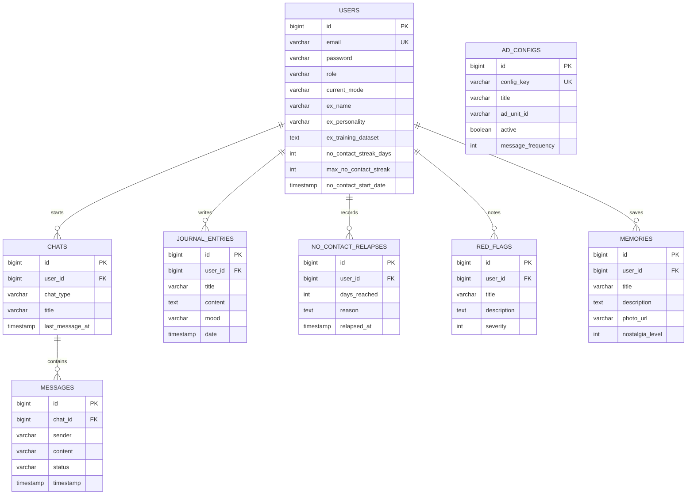

# No Contact & Emotional Recovery - Backend API

> **Author:** anubhavg-icpl (`anubhavg@infopercept.com`)

---

## Table of Contents
1. [Introduction](#1-introduction)
   - [1.1 Context](#11-context)
   - [1.2 Project Objectives](#12-project-objectives)
2. [Problem or Need Identification](#2-problem-or-need-identification)
   - [2.1 Problem Description](#21-problem-description)
   - [2.2 Justification](#22-justification)
3. [Solution Description](#3-solution-description)
   - [3.1 Implemented Features](#31-implemented-features)
   - [3.2 Technologies and Tools](#32-technologies-and-tools)
4. [Entity Model and Data Architecture](#4-entity-model-and-data-architecture)
   - [4.1 Entity-Relationship Diagram](#41-entity-relationship-diagram)
   - [4.2 Entity Descriptions](#42-entity-descriptions)
5. [Error Handling](#5-error-handling)
   - [5.1 Custom Exceptions](#51-custom-exceptions)
   - [5.2 Global Exception Handler and HTTP Codes](#52-global-exception-handler-and-http-codes)
6. [Implemented Security Measures](#6-implemented-security-measures)
   - [6.1 JWT Authentication and Authorization](#61-jwt-authentication-and-authorization)
   - [6.2 Roles and RBAC Access Control](#62-roles-and-rbac-access-control)
   - [6.3 Vulnerability Prevention](#63-vulnerability-prevention)
7. [Events and Asynchrony](#7-events-and-asynchrony)
   - [7.1 Domain Events with ApplicationEventPublisher](#71-domain-events-with-applicationeventpublisher)
   - [7.2 HTML Email Service with Thymeleaf](#72-html-email-service-with-thymeleaf)
8. [GitHub & Management](#8-github--management)
   - [8.1 Task Management with GitHub Projects](#81-task-management-with-github-projects)
   - [8.2 CI/CD Flow with GitHub Actions and Docker](#82-cicd-flow-with-github-actions-and-docker)
9. [Conclusion](#9-conclusion)
   - [9.1 Project Achievements](#91-project-achievements)
   - [9.2 Key Learnings](#92-key-learnings)
   - [9.3 Future Work](#93-future-work)
10. [Appendices and References](#10-appendices-and-references)
    - [10.1 Environment Variables](#101-environment-variables)
    - [10.2 Swagger / OpenAPI Documentation](#102-swagger--openapi-documentation)
    - [10.3 Postman Collection](#103-postman-collection)
    - [10.4 License and References](#104-license-and-references)

---

## 1. Introduction

### 1.1 Context
Romantic breakups trigger severe neurobiological and behavioral crises. The ubiquity of instant messaging apps intensifies the urge to break the distance, leading to harmful patterns of mental rumination and relapses. The **"No Contact"** psychological protocol prescribes suppressing all communication with the ex-partner in order to extinguish intermittent reinforcement. However, maintaining abstinence without structured support often fails during acute peaks of vulnerability.

### 1.2 Project Objectives
* **General Objective:** Develop a robust, secure, and scalable REST API in Spring Boot to manage the emotional recovery process, relapse auditing, and interactive containment assisted by Artificial Intelligence.
* **Specific Objectives:**
  1. Implement a clean layered architecture (Controller, Service, Repository) following SOLID principles.
  2. Provide stateless authentication through JWT with Refresh Token rotation and Google OAuth 2.0 integration.
  3. Implement an interactive chat simulator that replicates the ex's personality from historical chat datasets or provides support in Move-On Mode.
  4. Develop a decoupled event system (`@EventListener` + `@Async`) for automatic notifications via HTML email rendered with Thymeleaf.
  5. Ensure coverage through unit and integration tests on H2 and orchestrate deployment in Docker containers.

---

## 2. Problem or Need Identification

### 2.1 Problem Description
Existing digital solutions are limited to static counters or isolated note-taking journals. They lack reactive containment mechanisms for when the user feels the urge to message their ex. They provide no analysis of emotional triggers and no safe simulation to defuse the urgency without real-world consequences.

### 2.2 Justification
A specialized backend centralizes the analytical tracking of streaks, catalogs behavioral reminders (Red Flags and Memories), and provides an interactive emotional-release simulator. Switching between two operating modes (**REMEMBER Mode** to work through the grief and **MOVE_ON Mode** to reinforce detachment) optimizes the system's adaptive response.

---

## 3. Solution Description

### 3.1 Implemented Features
1. **Hybrid Authentication and Sessions:** Registration with passwords encrypted using BCrypt, login with access tokens and refresh tokens, and federated login with Google OAuth2.
2. **AI Ex Simulator & Chat Ingestion:** Interactive chat channel that emulates the ex's replies according to their personality or steps in with psychological guidelines. It includes the `/api/v1/users/ex-dataset` endpoint to process exported chat histories (WhatsApp/social media), analyzing idioms, emojis, and predominant tones.
3. **No Contact Metrics and Relapses:** Automatic calculation of active streaks, preservation of historical records, and auditable logging of relapse reasons.
4. **Cathartic Emotional Journal:** Creation and cataloging of reflective entries tied to specific moods.
5. **Memory Wall and Red Flags:** Structured inventory of memories with nostalgia weighting and a catalog of warning behaviors with severity levels.
6. **Administrative Module:** Protected endpoints for auditing global system metrics and dynamically managing ads.

### 3.2 Technologies and Tools
* **Language:** Java 21 LTS
* **Framework:** Spring Boot 4.1.x / Spring Data JPA / Spring Security 7
* **Template Engine:** Thymeleaf
* **Persistence:** PostgreSQL (production, e.g. Neon or any managed instance) / H2 In-Memory (unit tests)
* **Security:** Auth0 Java-JWT, Google API Client, BCrypt
* **Documentation & Testing:** SpringDoc OpenAPI 3 (Swagger UI), MockMvc, JUnit 5, Mockito
* **Infrastructure:** Docker, Docker Compose, AWS EC2

---

## 4. Entity Model and Data Architecture

### 4.1 Entity-Relationship Diagram



### 4.2 Entity Descriptions
* **`User`:** Root entity. Stores credentials, role (`ROLE_USER`, `ROLE_ADMIN`), AI clone settings, the dataset of learned idioms, and streak metrics.
* **`Chat`:** Conversation session categorized by `ChatType` (`CHAT_EX` or `CHAT_SUPPORT`), linked through lazy loading (`LAZY`).
* **`Message`:** Record of atomic interactions with a `Sender` discriminator (`USER`, `EX_BOT`, `SYSTEM`).
* **`JournalEntry`:** Reflective entries categorized by emotional state.
* **`NoContactRelapse`:** Audit of streak breaks with the reported triggers.
* **`RedFlag`:** Record of dysfunctional behaviors with a severity scale from 1 to 5.
* **`Memory`:** Multimedia memory wall with weighted nostalgia levels from 1 to 5.
* **`AdConfig`:** Dynamic configuration of ads and frequencies for the frontend clients (the `key` field is stored in the `config_key` column because `KEY` is a reserved word in H2).

---

## 5. Error Handling

### 5.1 Custom Exceptions
The system defines a coherent hierarchy extending a common base class `BaseAppException`:
* `ResourceNotFoundException` (404 Not Found)
* `DuplicateResourceException` (409 Conflict)
* `BadRequestException` (400 Bad Request)
* `InvalidOperationException` (400 Bad Request)
* `UnauthorizedException` (401 Unauthorized)
* `TokenExpiredException` (401 Unauthorized)
* `ForbiddenException` (403 Forbidden)
* `ExternalServiceException` (502 Bad Gateway)

### 5.2 Global Exception Handler and HTTP Codes
The centralized `@RestControllerAdvice` class (`GlobalExceptionHandler`) intercepts business exceptions and framework validations (`MethodArgumentNotValidException`), emitting structured responses in the standard format:

```json
{
  "timestamp": "2026-09-23T16:00:00.000",
  "status": 404,
  "error": "Not Found",
  "message": "Journal entry not found with id: 45",
  "path": "/api/v1/journals/45"
}
```

HTTP codes applied consistently: `200 OK`, `201 CREATED`, `204 NO CONTENT`, `400 BAD REQUEST`, `401 UNAUTHORIZED`, `403 FORBIDDEN`, `404 NOT FOUND`, `409 CONFLICT`, `500 INTERNAL SERVER ERROR`.

---

## 6. Implemented Security Measures

### 6.1 JWT Authentication and Authorization
* **Stateless Architecture:** Sessions are managed exclusively through cryptographic tokens signed with HMAC256.
* **`JwtAuthenticationFilter` Filter:** Intercepts `Authorization: Bearer <token>` headers, validates expiry, and populates the `SecurityContextHolder`.
* **Access and Refresh Tokens:** Short-lived access tokens (24 hours) and persistent refresh tokens for secure renewal.
* **BCrypt Encryption:** Passwords are irreversibly hashed with an industrial-strength cost factor.

### 6.2 Roles and RBAC Access Control
Through `@EnableMethodSecurity`, the system restricts sensitive endpoints with `@PreAuthorize("hasRole('ADMIN')")`. The `AdminController` allows only users with `ROLE_ADMIN` to inspect global metrics and modify system ads, returning `403 Forbidden` to users with `ROLE_USER`.

### 6.3 Vulnerability Prevention
* **SQL Injection:** Fully prevented through parameterized queries and Spring Data JPA abstractions.
* **CORS:** Granular configuration enabling authorized origins and headers.
* **Input Validation:** DTOs with Bean Validation annotations (`@NotBlank`, `@Email`, `@Min`, `@Max`).

---

## 7. Events and Asynchrony

### 7.1 Domain Events with ApplicationEventPublisher
The Observer pattern is used to decouple business transactions from asynchronous tasks:
* **`UserRegisteredEvent`:** Emitted in `AuthService` after a new user is registered.
* **`RelapseRecordedEvent`:** Fired in `NoContactService` when a streak break is recorded.

### 7.2 HTML Email Service with Thymeleaf
The `AppEventListener` class handles the events and delegates execution to the `EmailService` through `@Async("taskExecutor")`. Emails are built with Thymeleaf's `SpringTemplateEngine`, feeding decoupled HTML templates (`email-welcome.html` and `email-relapse.html`) styled for a modern look and visual support during vulnerable moments.

---

## 8. GitHub & Management

### 8.1 Task Management with GitHub Projects
Development was organized on a Kanban board in GitHub Projects structured as Backlog, In Progress, Review, and Done. Requirements were broken down into issues with descriptive labels (`feature`, `security`, `documentation`).

### 8.2 CI/CD Flow with GitHub Actions and Docker
* **Continuous Integration:** Pipeline in `.github/workflows/` that compiles the code and runs the full unit test suite against an H2 database on every Pull Request.
* **Deployment:** The application is packaged as a Docker image (see `Dockerfile` and `docker-compose.yml`) and deployed to an AWS EC2 instance exposed on port 8080, connecting to a managed PostgreSQL database.

---

## 9. Conclusion

### 9.1 Project Achievements
* Complete backend covering auth, journaling, no-contact tracking, memories, red flags, AI chat and admin modules.
* Integration of 8 complete JPA entities, 25 specialized DTOs, and exhaustive exception handling.
* Green automated test suite that runs without external network dependencies.
* Incorporation of chat dataset ingestion inspired by conversational AI cloning models.

### 9.2 Key Learnings
* Strict isolation of entities through DTOs guarantees credential confidentiality and prevents JSON serialization cycles.
* Asynchronous event-driven processing improves HTTP client response times for processes with blocking I/O (SMTP emails).
* Using embedded databases (H2) in test profiles guarantees reproducible CI pipelines that are independent of cloud credentials.

### 9.3 Future Work
1. Implementation of WebSockets (STOMP) for real-time message streaming in the simulator.
2. Deployment of a dedicated Python microservice with PyTorch/FastAPI for inference based on embeddings or fine-tuning of local LLM models (the backend already calls an AI service at `http://localhost:8000/predict` with `message`, `mode`, and `personality`).
3. Incorporation of sentiment-detection algorithms in the emotional journal.

---

## 10. Appendices and References

### 10.1 Environment Variables
Defaults below match `src/main/resources/application.yaml`.

* `DB_URL`: PostgreSQL JDBC URL (default `jdbc:postgresql://localhost:5432/nocontact_db`; for a managed database use e.g. `jdbc:postgresql://<host>:5432/<db>?sslmode=require`).
* `DB_USER`: Database user (default `nocontact_user`).
* `DB_PASSWORD`: Database access credential (default is the local docker-compose development password; always override it outside local development).
* `JWT_SECRET`: Cryptographic HMAC256 secret key (the built-in default is for development only; always override it in production).
* `JWT_ACCESS_EXPIRATION`: Access token lifetime in milliseconds (default `86400000`, 24 hours).
* `JWT_REFRESH_EXPIRATION`: Refresh token lifetime in milliseconds (default `604800000`, 7 days).
* `MAIL_HOST`: SMTP host (default `smtp.gmail.com`).
* `MAIL_PORT`: SMTP port (default `587`).
* `MAIL_USERNAME`: SMTP user (default empty).
* `MAIL_PASSWORD`: SMTP password (default empty).
* `PORT`: Server listening port (default `8080`).

### 10.2 Swagger / OpenAPI Documentation
The interactive OpenAPI 3 documentation is available on the local or deployed server:
* **Swagger UI:** `http://localhost:8080/swagger-ui/index.html` (or `/swagger-ui.html`)
* **OpenAPI JSON:** `http://localhost:8080/v3/api-docs`

### 10.3 Postman Collection
The full collection with all required endpoints, environment variables, and scripts that automatically capture JWT tokens is in the repository root: [`postman_collection.json`](./postman_collection.json).

Endpoint summary (all under `/api/v1`):

| Area | Endpoints |
|------|-----------|
| Auth | `POST /auth/register`, `POST /auth/login`, `POST /auth/refresh`, `POST /auth/google` |
| Users | `GET /users/profile`, `PUT /users/ex-config`, `PATCH /users/mode`, `POST /users/ex-dataset` |
| Chats | `GET /chats`, `GET /chats/{type}`, `POST /chats/{chatId}/messages`, `DELETE /chats/{chatId}/messages` |
| Journals | `GET /journals`, `POST /journals`, `DELETE /journals/{id}` |
| No Contact | `GET /no-contact/statistics`, `GET /no-contact/relapses`, `POST /no-contact/relapses` |
| Red Flags | `GET /red-flags`, `POST /red-flags`, `DELETE /red-flags/{id}` |
| Memories | `GET /memories`, `POST /memories`, `DELETE /memories/{id}` |
| Admin (`ROLE_ADMIN`) | `GET /admin/global-metrics`, `GET /admin/ads`, `POST /admin/ads`, `PATCH /admin/ads/{id}/toggle`, `GET /admin/ads/active` |

### 10.4 License and References
* **License:** Distributed under the **MIT License**.
* **References:**
  1. Vaswani, A., et al. (2017). *Attention Is All You Need*. NeurIPS.
  2. Brown, T., et al. (2020). *Language Models are Few-Shot Learners*. NeurIPS.
  3. Spring Framework & Spring Security Documentation (2026).
  4. JustZando (2026). *Turning my ex girlfriend into an AI because I miss her*. YouTube.
